# KIP Student Eligibility Prediction

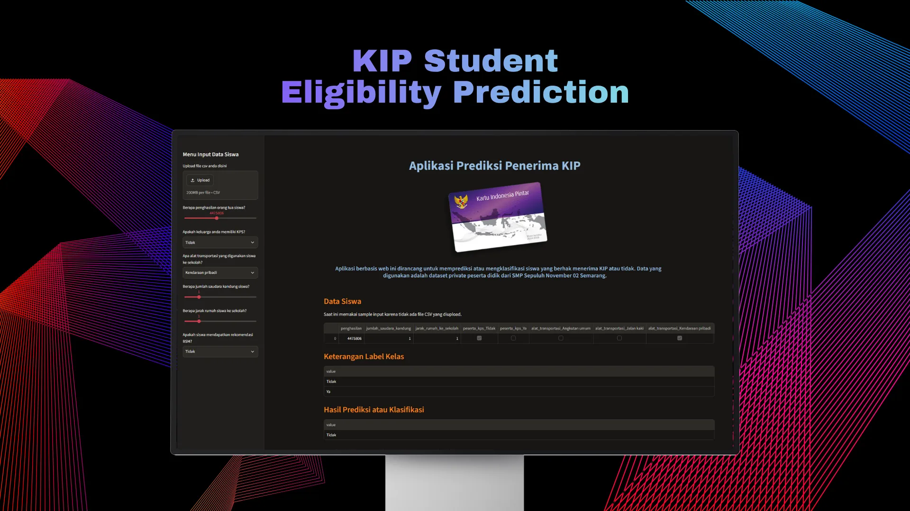


## Project Overview

KIP Student Eligibility Prediction is a supervised machine learning classification and interactive inference project built to assess student eligibility for the Kartu Indonesia Pintar (KIP) educational assistance program using socioeconomic and school-access records from SMP Sepuluh November 02 Semarang. The repository combines exploratory notebook modeling with a Gaussian Naive Bayes classifier (`GaussianNB`), diagnostic evaluation visualizations, and a Streamlit web application supporting both single-student interactive simulation and batch CSV prediction.

## Problem Statement & Objectives

Determining whether junior high school students qualify for KIP financial aid requires evaluating multiple household socioeconomic indicators, prior social program participation, and commuting constraints consistently across hundreds of student records. Manual screening can introduce inconsistency when balancing numerical attributes (such as parental income) alongside categorical indicators (such as prior BSM recommendations or KPS membership).

- Train a probabilistic binary classification model (`GaussianNB`) on structured student records to predict KIP eligibility (`Ya` vs `Tidak`).
- Transform raw mixed-type student attributes into a deterministic 10-feature numerical input vector via one-hot encoding.
- Evaluate model discrimination, class-imbalance behavior, and decision-threshold sensitivity using confusion matrices, ROC-AUC, and Precision-Recall diagnostics.
- Deliver an accessible Streamlit web interface (`streamlit/kip_webapp.py`) for real-time individual eligibility simulation and CSV upload inference.

## Data & Input Sources

The modeling pipeline relies on a local tabular dataset (`dataset.csv`) derived from student records of SMP Sepuluh November 02 Semarang (alongside the raw Excel roster `daftar_pd-SMP SEPULUH NOPEMBER 2-2022-08-04 14_00_58.xlsx` and a single-row sample inference CSV `1.csv`). The cleaned modeling dataset contains 500 complete student records with zero missing values across six input features and one binary target column.

| Attribute | Description |
| --- | --- |
| Dataset / Input Source | `dataset.csv` (SMP Sepuluh November 02 Semarang student records) and `1.csv` (sample inference row) |
| Source | Local repository paths (`dataset.csv`, `1.csv`, `streamlit/dataset.csv`, `streamlit/1.csv`) |
| Format | Tabular CSV (with raw roster source in `.xlsx`) |
| Samples / Records | 500 student records (`408` Non-Recipient / `Tidak`, `92` Recipient / `Ya`) |
| Features / Input Shape | 6 raw features (`penghasilan`, `peserta_kps`, `alat_transportasi`, `jumlah_saudara_kandung`, `jarak_rumah_ke_sekolah`, `rekomendasi_bsm`) expanded to 10 one-hot encoded features |
| Target / Label | `penerima_kip` (`Tidak` -> `0` [81.6%], `Ya` -> `1` [18.4%]) |

## Data Preprocessing & Feature Engineering

Because the Gaussian Naive Bayes estimator requires numeric inputs while student records combine continuous/discrete quantities and nominal categories, both the training notebook ([Model Klasifikasi KIP.ipynb](Model%20Klasifikasi%20KIP.ipynb)) and the serving application ([streamlit/kip_webapp.py](streamlit/kip_webapp.py)) implement consistent categorical encoding and schema alignment prior to inference.

| Feature / Column | Transformation | Input Type | Output Representation |
| --- | --- | --- | --- |
| `peserta_kps` | One-hot encoding (`pd.get_dummies`) | Categorical (`Ya`, `Tidak`) | `peserta_kps_Tidak`, `peserta_kps_Ya` |
| `alat_transportasi` | One-hot encoding (`pd.get_dummies`) | Categorical (`Jalan kaki`, `Angkutan umum`, `Kendaraan pribadi`) | `alat_transportasi_Angkutan umum`, `alat_transportasi_Jalan kaki`, `alat_transportasi_Kendaraan pribadi` |
| `rekomendasi_bsm` | One-hot encoding (`pd.get_dummies`) | Categorical (`Ya`, `Tidak`) | `rekomendasi_bsm_Tidak`, `rekomendasi_bsm_Ya` |
| `penghasilan`, `jumlah_saudara_kandung`, `jarak_rumah_ke_sekolah` | Direct numeric passthrough | Integer (`Rp 800,000–4,000,000`, `1–3` siblings, `1–5` distance scale) | 3 numeric columns |
| `penerima_kip` | Binary label mapping (training & evaluation only) | Categorical (`Tidak`, `Ya`) | Integer binary target (`0`, `1`) |

1. Load `dataset.csv` and isolate the six predictor columns from the `penerima_kip` target variable.
2. Apply `pd.get_dummies` across `peserta_kps`, `alat_transportasi`, and `rekomendasi_bsm` with explicit prefixes to expand the feature space from 6 raw columns to 10 binary/numeric features.
3. During Streamlit inference, concatenate the user input (slider/selectbox values or uploaded CSV) on top of the reference `dataset.csv` feature frame before applying `pd.get_dummies`, then slice `df[:1]` so all 10 expected dummy columns remain aligned regardless of single-row category values.

## Tech Stack

| Category | Technology | Purpose |
| --- | --- | --- |
| Language | Python | Core scripting, data preprocessing, model training, and web app execution |
| ML Framework | Scikit-learn | `GaussianNB` classifier training, probability estimation, and evaluation metrics |
| Data Manipulation | Pandas | Tabular CSV ingestion, one-hot encoding (`get_dummies`), and feature alignment |
| Numerical Computing | NumPy | Array operations, threshold optimization, and class label indexing |
| Web Serving | Streamlit | Interactive sidebar form, CSV upload, and real-time prediction dashboard |
| Visualization | Matplotlib, Seaborn | Exploratory data analysis charts, heatmaps, confusion matrices, and ROC/PR curves |
| Model Serialization | Pickle | Saving and loading the trained `modelNBC_kip.pkl` binary artifact |
| Image Handling | Pillow | Rendering the KIP card visual asset inside the Streamlit interface |
| Experiment Environment | Jupyter Notebook | Interactive preprocessing, model fitting, and artifact export |

## Machine Learning Approach

The project formulates student KIP eligibility screening as a supervised binary classification task over tabular socioeconomic data. Using labeled historical eligibility outcomes, the model learns conditional feature likelihoods and empirical class priors to output both discrete eligibility classifications and calibrated posterior class probabilities.

| Attribute | Value |
| --- | --- |
| Learning Paradigm | Supervised Learning |
| Problem Domain | Educational Aid & Socioeconomic Tabular Screening |
| ML Task | Binary Classification (`penerima_kip`: `Tidak` vs `Ya`) |
| Input Representation | 10-dimensional numerical and one-hot encoded feature vector |
| Output | Predicted class (`0` = `Tidak`, `1` = `Ya`) and class probability vector `P(y|x)` |

## Model Overview

The core estimator is Scikit-learn's `GaussianNB` (Gaussian Naive Bayes), serialized as `modelNBC_kip.pkl`. It estimates per-class feature means and variances assuming conditional independence and Gaussian feature distributions, combined with empirical class priors learned directly from the 500-record dataset (`0.816` for `Tidak`, `0.184` for `Ya`).

| Attribute | Details |
| --- | --- |
| Model Name | `modelNBC_kip.pkl` |
| Algorithm / Architecture | Gaussian Naive Bayes (`sklearn.naive_bayes.GaussianNB`) |
| Framework | Scikit-learn |
| Input Features | 10 features (`3` numerical + `7` one-hot encoded categorical columns) |
| Output Classes | 2 classes (`0`: `Tidak` [408 samples], `1`: `Ya` [92 samples]) |
| Pretrained Status | Trained in this project via [Model Klasifikasi KIP.ipynb](Model%20Klasifikasi%20KIP.ipynb) |

## ML Workflow

1. **Data Loading & Exploration**: Ingest the 500-record tabular dataset from [dataset.csv](dataset.csv) and inspect feature distributions and class balance.
2. **Categorical Encoding & Target Mapping**: One-hot encode `peserta_kps`, `alat_transportasi`, and `rekomendasi_bsm` and map `penerima_kip` (`Tidak` -> `0`, `Ya` -> `1`) inside [Model Klasifikasi KIP.ipynb](Model%20Klasifikasi%20KIP.ipynb).
3. **Model Training**: Fit `GaussianNB()` on the full 500-sample encoded feature matrix `x` and target vector `y`.
4. **Artifact Serialization**: Persist the fitted classifier to [modelNBC_kip.pkl](modelNBC_kip.pkl) using `pickle.dump` (and mirror it inside `streamlit/modelNBC_kip.pkl`).
5. **Diagnostic Evaluation & Visualization**: Run [generate_figures.py](generate_figures.py) to generate 10 EDA and model evaluation plots in `figures/`, computing confusion matrices, ROC-AUC, PR-AUC, and Youden's Index optimal probability threshold.
6. **Interactive Web Inference**: Serve real-time predictions and class probabilities through [streamlit/kip_webapp.py](streamlit/kip_webapp.py) using sidebar controls or uploaded CSV files such as [1.csv](1.csv).

## ML Pipeline Architecture

The repository implements an end-to-end local pipeline spanning offline model training, diagnostic analysis, and interactive Streamlit inference sharing a unified one-hot encoding schema.

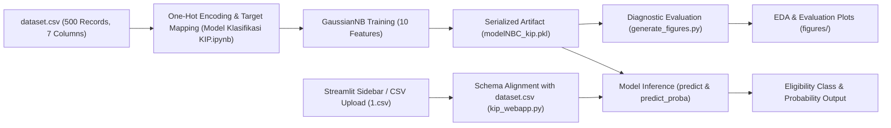

## Model Training & Configuration

In [Model Klasifikasi KIP.ipynb](Model%20Klasifikasi%20KIP.ipynb), the `GaussianNB` classifier is instantiated with Scikit-learn's default configuration (`priors=None`, `var_smoothing=1e-09`) and fitted directly on all 500 encoded student records (`x.shape == (500, 10)`) without a separate holdout validation split. Because `GaussianNB` computes closed-form per-class means, variances, and empirical priors in a single pass, training requires no iterative gradient optimization, epoch schedule, or random seed.

| Configuration Parameter | Verified Value | Description |
| --- | --- | --- |
| Estimator | `sklearn.naive_bayes.GaussianNB` | Closed-form Gaussian Naive Bayes classifier |
| `priors` | `None` | Uses empirical dataset priors (`[0.816, 0.184]`) |
| `var_smoothing` | `1e-09` | Variance stability floor added to feature variances |
| Training Split Strategy | Full-dataset fit (500 / 500 samples) | Trained on all records in `dataset.csv` without holdout split |
| Input Feature Count | `10` | 3 continuous/discrete features + 7 one-hot columns |
| Serialization | `pickle.dump` | Exports trained estimator to `modelNBC_kip.pkl` |

```python
from sklearn.naive_bayes import GaussianNB
import pickle

model = GaussianNB()
model.fit(x, y)
pickle.dump(model, open('modelNBC_kip.pkl', 'wb'))
```

## Model Artifacts & Checkpoints

All trained model binaries and companion inference data files are stored directly in the repository root and mirrored in `streamlit/` for standalone app execution.

| Artifact Name | Format | Purpose | Location |
| --- | --- | --- | --- |
| `modelNBC_kip.pkl` | Pickle (`.pkl`) | Serialized `GaussianNB` classifier trained on 500 student records | [modelNBC_kip.pkl](modelNBC_kip.pkl) / [streamlit/modelNBC_kip.pkl](streamlit/modelNBC_kip.pkl) |
| `dataset.csv` | CSV (`.csv`) | Reference dataset used for training, evaluation, and dummy-column alignment | [dataset.csv](dataset.csv) / [streamlit/dataset.csv](streamlit/dataset.csv) |
| `1.csv` | CSV (`.csv`) | Sample single-student input record for CSV upload inference testing | [1.csv](1.csv) / [streamlit/1.csv](streamlit/1.csv) |

## Model Evaluation & Results

Diagnostic evaluation in [generate_figures.py](generate_figures.py) assesses the serialized `modelNBC_kip.pkl` across the 500-record dataset (full-dataset evaluation, as no separate test split was held out during notebook training). Under the default `0.50` probability threshold, strong empirical class imbalance (`81.6%` `Tidak` vs `18.4%` `Ya`) and Gaussian variance dominated by `penghasilan` cause the model to predict `Tidak` for all 500 samples (`81.60%` overall accuracy, `0.00%` minority-class recall). Applying Youden's Index (`tpr - fpr`) identifies an optimal threshold of `0.1811`, recovering `55.43%` sensitivity (`51` TP, `41` FN) at `51.72%` specificity (`211` TN, `197` FP), while ranking discrimination remains modest at `0.522` ROC-AUC and `0.196` PR-AP (compared to the `0.184` no-skill prevalence baseline).

| Evaluation Split & Setting | Metric | Observed Value | Notes |
| --- | --- | --- | --- |
| Full Dataset (`n=500`, Default Threshold `0.50`) | Accuracy | `81.60%` | `408` TN, `0` FP, `92` FN, `0` TP (majority-class collapse) |
| Full Dataset (`n=500`, Default Threshold `0.50`) | Minority Class (`Ya`) Recall / F1 | `0.00%` / `0.000` | No positive predictions above `0.50` probability |
| Full Dataset (`n=500`, Probability Ranking) | ROC-AUC | `0.522` | Modest ranking separation across thresholds |
| Full Dataset (`n=500`, Probability Ranking) | PR Average Precision (AP) | `0.196` | Slightly above `0.184` random-guess baseline |
| Full Dataset (`n=500`, Optimal Threshold `0.1811`) | Sensitivity (Recall `Ya`) | `55.43%` | `51` true positives detected out of `92` recipients |
| Full Dataset (`n=500`, Optimal Threshold `0.1811`) | Specificity / Accuracy | `51.72%` / `52.40%` | `211` TN, `197` FP (`F1 = 0.300` for `Ya`) |

- **Class Imbalance & Feature Scale Effect**: Because `penghasilan` spans `800,000` to `4,000,000` IDR while binary one-hot features span `0` to `1`, unscaled Gaussian variance and `81.6%` negative prior suppress default posterior probabilities below `0.50`.
- **Strongest Univariate Signal**: Pearson correlation and recipient-profile analysis show `rekomendasi_bsm` has the strongest linear association with KIP eligibility (`r = +0.21`), with `65.2%` of KIP recipients holding a BSM recommendation versus `38.0%` of non-recipients.
- **No Separate Holdout Split**: Because [Model Klasifikasi KIP.ipynb](Model%20Klasifikasi%20KIP.ipynb) fits on all 500 rows, reported metrics measure in-sample behavior rather than out-of-sample generalization.

## Results Visualization & Preview

### 1. Streamlit Web Application Interface
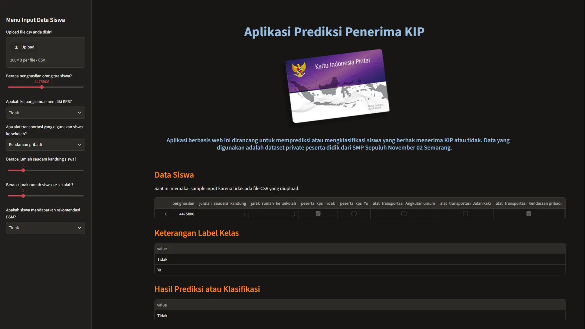
Full-page view of the Streamlit `Aplikasi Prediksi Penerima KIP` interface showing the interactive sidebar (`Menu Input Data Siswa`) with CSV upload, income/sibling/distance sliders, and categorical selectors alongside the real-time encoded feature preview (`Data Siswa`), class label mapping, and predicted KIP eligibility output.

### 2. Target Class Distribution (KIP Recipients vs Non-Recipients)
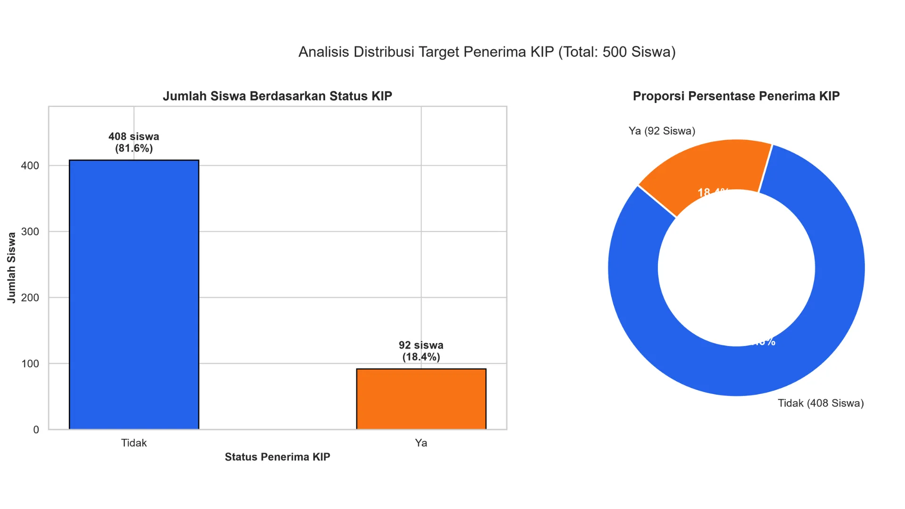
Bar and donut charts summarizing the 500-student dataset target distribution (`penerima_kip`), revealing a pronounced class imbalance of 408 non-recipients (`Tidak`, 81.6%) versus 92 KIP recipients (`Ya`, 18.4%).

### 3. Parental Income Distribution by KIP Status
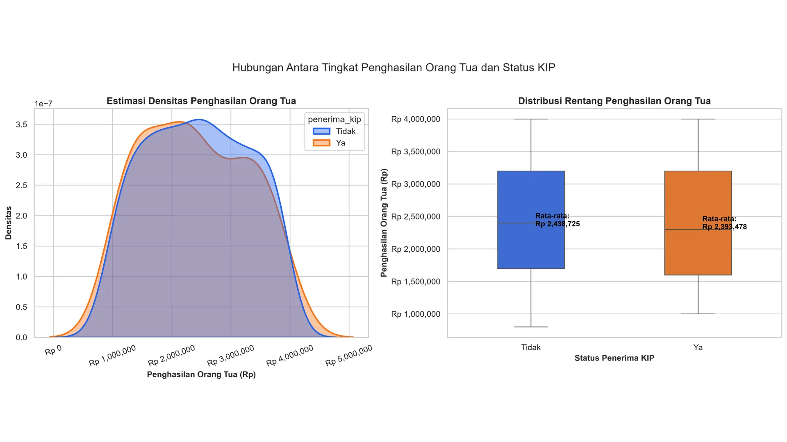
Kernel density estimation (KDE) and boxplots comparing parental income (`penghasilan`) between non-recipients (mean IDR 2,438,725) and KIP recipients (mean IDR 2,393,478), illustrating heavy distribution overlap across the IDR 800,000–4,000,000 range.

### 4. Impact of Prior Aid Programs (KPS & BSM Recommendation)
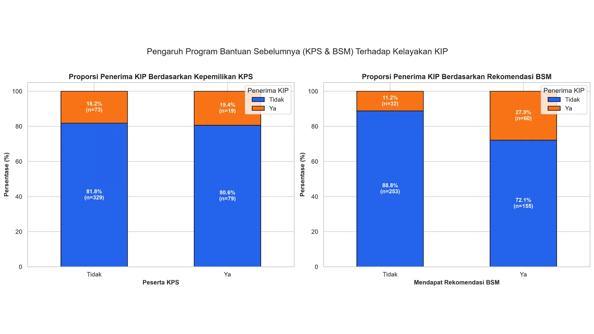
Stacked percentage bar charts evaluating prior social assistance indicators, demonstrating that KPS membership (`peserta_kps`) yields similar KIP rates (19.4% vs 18.2%) whereas a BSM recommendation (`rekomendasi_bsm`) increases KIP acceptance from 11.2% (`n=32`) to 27.9% (`n=60`).

### 5. Student Transportation Mode & KIP Acceptance Rate
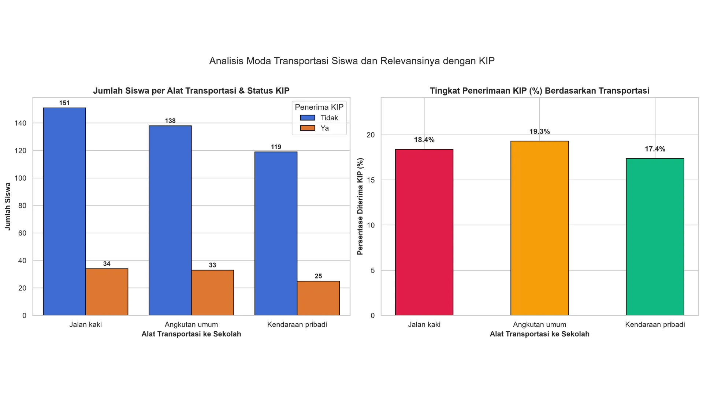
Grouped student counts and KIP acceptance rates across commuting modes, showing comparable recipient proportions across walking (`Jalan kaki`, 18.4%), public transit (`Angkutan umum`, 19.3%), and private vehicles (`Kendaraan pribadi`, 17.4%).

### 6. Sibling Count & Home-to-School Distance Breakdown
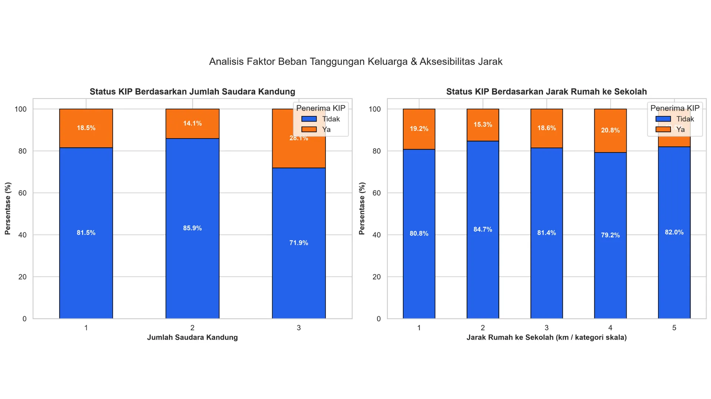
Normalized stacked bar charts examining household size (`jumlah_saudara_kandung`) and distance scale (`jarak_rumah_ke_sekolah`), highlighting a higher 28.1% KIP recipient share among students with 3 siblings compared to 14.1%–18.5% for 1–2 siblings.

### 7. Pearson Feature Correlation Heatmap
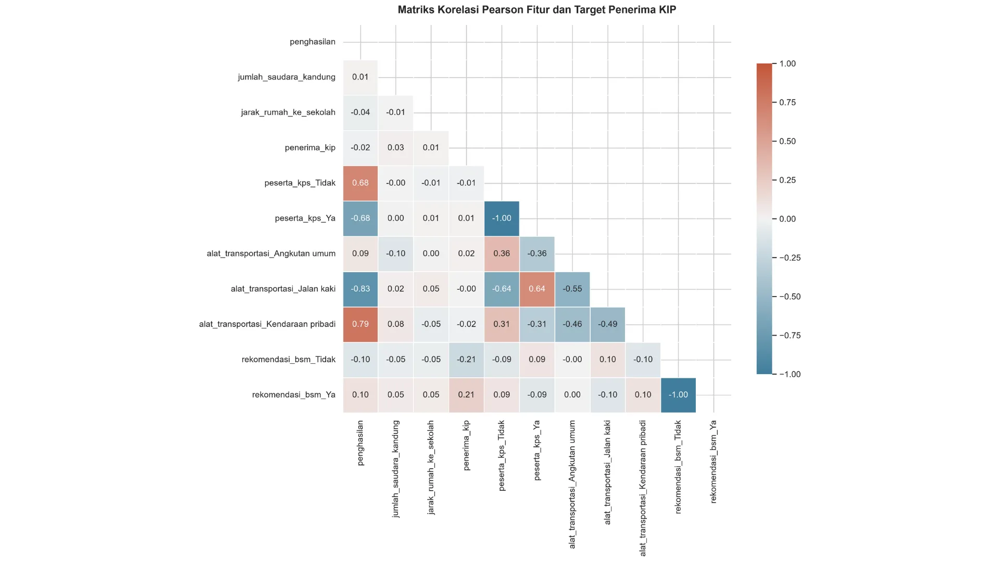
Lower-triangular Pearson correlation matrix across all 10 one-hot encoded features and `penerima_kip`, confirming `rekomendasi_bsm_Ya` (`+0.21`) as the strongest target correlate alongside strong socioeconomic relationships between `penghasilan` and private vehicle ownership (`+0.79`) or walking (`-0.83`).

### 8. Gaussian Naive Bayes Confusion Matrix Comparison
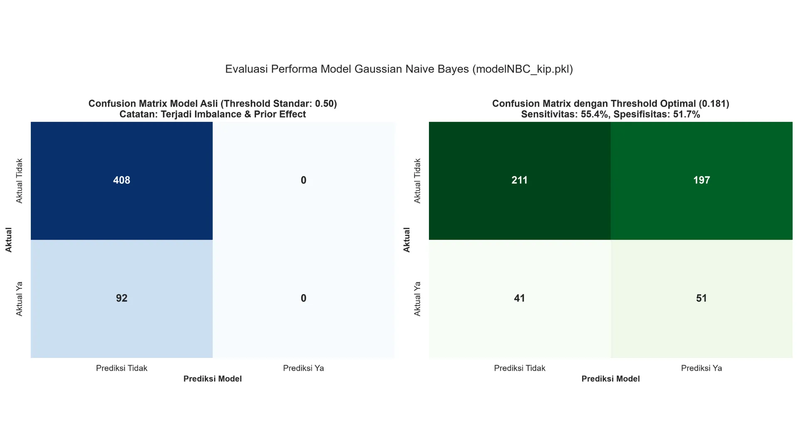
Side-by-side confusion matrices comparing the default `0.50` probability threshold (408 TN, 92 FN, 0 TP due to class-prior dominance) against the Youden's Index optimal threshold of `0.181` (211 TN, 197 FP, 41 FN, 51 TP; 55.4% sensitivity and 51.7% specificity).

### 9. ROC & Precision-Recall Discrimination Curves
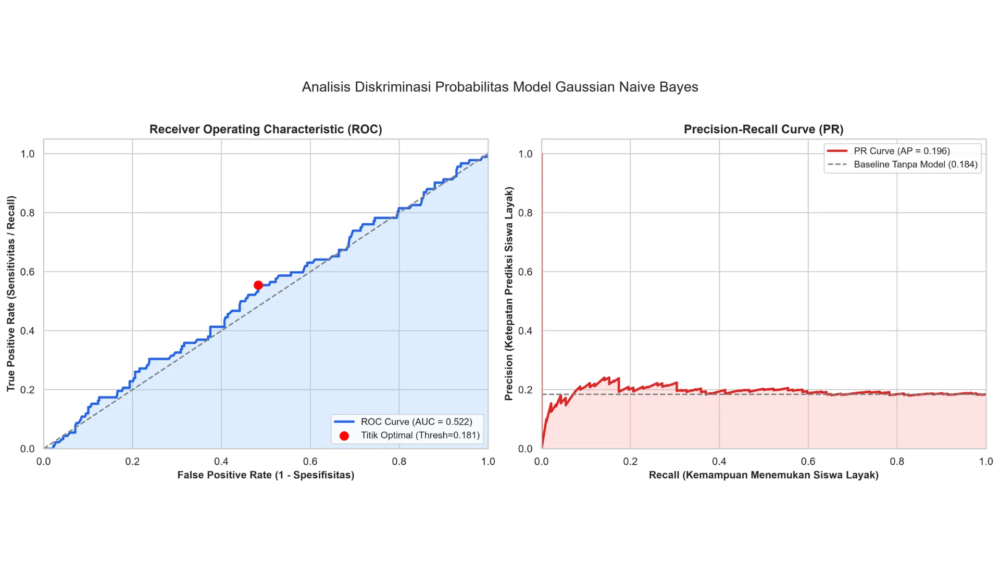
Receiver Operating Characteristic (`ROC-AUC = 0.522` with optimal threshold `0.181` highlighted) and Precision-Recall (`AP = 0.196` against the `0.184` no-skill baseline) curves quantifying the classifier's probability ranking performance under class imbalance.

### 10. Multivariate Socioeconomic & Commuting Scatter Plot
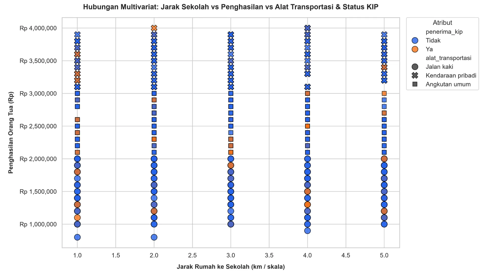
Multivariate scatter plot mapping school distance against parental income, differentiated by KIP status and transportation mode, revealing clear income stratification across commuting types (walking clustered below IDR 2.0M, public transit IDR 2.1M–3.0M, private vehicles above IDR 3.1M).

### 11. Recipient vs Non-Recipient Average Profile Comparison
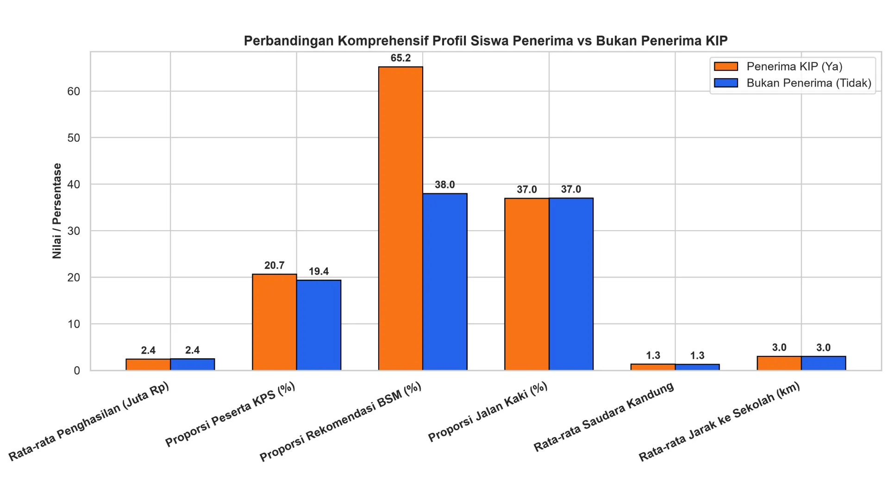
Grouped bar chart comparing mean feature values across KIP recipients (`Ya`) and non-recipients (`Tidak`), visually confirming nearly identical averages in income (`2.4M`), walking share (`37.0%`), siblings (`1.3`), and distance (`3.0`), with `rekomendasi_bsm` (`65.2%` vs `38.0%`) serving as the primary differentiator.

## Prerequisites

- Python 3.8 or higher (CPU execution only; no GPU or CUDA required)
- `pip` package manager
- Python packages used in the repository: `scikit-learn`, `pandas`, `numpy`, `streamlit`, `matplotlib`, `seaborn`, `pillow`
- Jupyter Notebook or JupyterLab (only required if re-running [Model Klasifikasi KIP.ipynb](Model%20Klasifikasi%20KIP.ipynb))

## Installation & Setup

1. Clone the repository and move into the project directory:
   ```bash
   git clone https://github.com/weztcy/KIP-Student-Eligibility-Prediction.git
   cd "KIP Student Eligibility Prediction"
   ```
2. Create and activate a virtual environment:
   ```bash
   python -m venv .venv
   # Windows PowerShell:
   .venv\Scripts\Activate.ps1
   # Linux/macOS:
   source .venv/bin/activate
   ```
3. Install the required Python libraries used across the notebook, visualization script, and Streamlit app:
   ```bash
   pip install scikit-learn pandas numpy streamlit matplotlib seaborn pillow jupyter
   ```

## Usage & Execution

Use the commands below to launch the interactive web application or regenerate the exploratory and evaluation figures locally.

1. Run the Streamlit web application from the `streamlit/` directory (so relative paths to `kip.png`, `dataset.csv`, and `modelNBC_kip.pkl` resolve cleanly):
   ```bash
   cd streamlit
   streamlit run kip_webapp.py
   ```
2. Interact with the sidebar sliders and dropdowns (`Menu Input Data Siswa`) to simulate individual students, or upload a formatted CSV file (such as `1.csv`) to view encoded feature alignment, predicted class (`Tidak` / `Ya`), and class probabilities.
3. Generate all 10 analytical and evaluation plots into `figures/` from the repository root:
   ```bash
   python generate_figures.py
   ```

## Model Deployment & Serving

The trained classifier is served locally through [streamlit/kip_webapp.py](streamlit/kip_webapp.py), which provides a browser-based decision-support UI powered by `modelNBC_kip.pkl`.

1. Ensure `streamlit/kip_webapp.py`, `streamlit/modelNBC_kip.pkl`, `streamlit/dataset.csv`, and `streamlit/kip.png` are present in `streamlit/`.
2. Start the local Streamlit server on the default port (`8501`):
   ```bash
   cd streamlit
   streamlit run kip_webapp.py
   ```
3. Open `http://localhost:8501` in a browser to perform interactive single-record or CSV-uploaded eligibility predictions.

## Reproducibility & Execution

Because `GaussianNB` computes deterministic closed-form parameter estimates (class priors, feature means, and variances) without stochastic initialization or random train/test splitting, re-running training on `dataset.csv` yields deterministic model parameters given matching Scikit-learn and Pandas versions.

1. Open [Model Klasifikasi KIP.ipynb](Model%20Klasifikasi%20KIP.ipynb) in Jupyter and run all 17 cells sequentially from the repository root to rebuild `modelNBC_kip.pkl` from `dataset.csv`.
2. Copy the updated `modelNBC_kip.pkl` into `streamlit/` if refreshing the serving binary.
3. Execute `python generate_figures.py` from the repository root to reproduce all 10 confusion matrix, ROC/PR, correlation, and EDA plots in `figures/`.
4. **Limitation**: No `requirements.txt` lockfile or train/test split is included in the repository; cross-version `pickle` deserialization warnings may occur if loading `modelNBC_kip.pkl` under a significantly newer Scikit-learn version than the original 2023 build environment.

## Contributing

Contributions to improve feature preprocessing, address class imbalance, or extend model benchmarking are welcome through the standard pull request workflow.

1. Fork the repository.
2. Create a branch for the change.
3. Make the changes.
4. Run relevant checks or tests when available (e.g., `python generate_figures.py` and `streamlit run kip_webapp.py`).
5. Commit and push the branch.
6. Open a pull request with a clear explanation.

## License

This project is licensed under the MIT License.
See the [LICENSE](LICENSE) file for details.

## Author & Contact

**Yohanes Dimas Pratama**

- GitHub: [github.com/weztcy](https://github.com/weztcy)
- Portfolio: [yohanesdimas.com](https://yohanesdimas.com)
- LinkedIn: [linkedin.com/in/yohanes-dimas](https://www.linkedin.com/in/yohanes-dimas)
