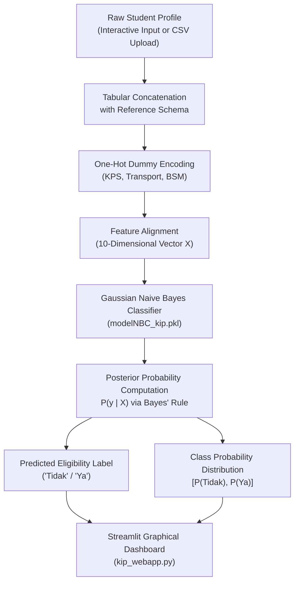

# KIP Student Eligibility Prediction

[](https://www.python.org/)
[](https://streamlit.io/)
[](https://scikit-learn.org/)
[](https://pandas.pydata.org/)
[](https://numpy.org/)
[](https://jupyter.org/)
[](./LICENSE)


**KIP Student Eligibility Prediction** is a machine learning classification system and interactive decision-support web application designed to evaluate and predict student eligibility for the **Kartu Indonesia Pintar (KIP)** educational scholarship program.

The *Program Indonesia Pintar* (PIP), realized through the distribution of the *Kartu Indonesia Pintar* (KIP), represents Indonesia's national educational safety net aimed at preventing school dropouts and guaranteeing 12 years of compulsory basic education for students from underprivileged socioeconomic backgrounds. In secondary educational institutions—such as junior high schools (*Sekolah Menengah Pertama* / SMP)—evaluating candidate eligibility from extensive administrative records (such as national *Dapodik* student profiles) is frequently time-consuming, labor-intensive, and susceptible to administrative inconsistencies.

This project resolves this operational challenge by implementing an automated supervised learning pipeline. By modeling empirical student demographic and socioeconomic criteria—including parental income, family social welfare participation (*Kartu Perlindungan Sosial* / KPS), daily transportation mode, sibling count, home-to-school distance, and *Bantuan Siswa Miskin* (BSM) recommendations—a **Gaussian Naive Bayes (`GaussianNB`)** probabilistic classifier categorizes prospective students into eligible (`Ya`) or non-eligible (`Tidak`) recipients. The trained classifier is serialized and integrated into an interactive **Streamlit** web application, providing school administrative committees with real-time classification, probability scoring, and both manual and batch CSV evaluation capabilities.

---

## Objectives & Use Cases

- **Automated Scholarship Decision Support**: Accelerate institutional assessment of KIP aid applicants by automatically predicting recipient eligibility from verified socioeconomic indicators.
- **Multimodal Data Ingestion**: Provide educational administrators with flexible entry methods: single-candidate evaluation via interactive graphical controls or bulk candidate processing via structured CSV file upload.
- **Socioeconomic Relationship Modeling**: Quantify conditional statistical dependencies between parental income levels, government social security program participation (KPS), and prior educational aid recommendations.
- **Transparent Posterior Confidence Scoring**: Compute continuous posterior class probabilities ($P(\text{Eligible} \mid X)$ vs. $P(\text{Ineligible} \mid X)$) rather than opaque binary verdicts, allowing administrative review committees to inspect borderline cases with calibrated certainty.
- **Consistent & Objective Evaluation**: Establish reproducible, standardized criteria screening to minimize subjective human bias in public educational assistance distribution.

---

## Features

- **Automated Tabular Preprocessing & Feature Encoding**:
  - Ingests structured student profiles containing continuous numerical indicators (parental income, sibling count, commute distance) and categorical indicators (KPS card participation, transportation mode, BSM assistance status).
  - Dynamically aligns categorical one-hot encoding across incoming user queries and the baseline training schema (`peserta_kps`, `alat_transportasi`, `rekomendasi_bsm`) to eliminate feature mismatch during single-record inference.
- **Gaussian Naive Bayes Probabilistic Modeling**:
  - Leverages scikit-learn's `GaussianNB` to compute maximum a posteriori (MAP) class classifications based on class prior distributions and Gaussian feature likelihoods.
- **Interactive Streamlit Web Dashboard**:
  - Custom UI engineered with Streamlit featuring responsive navigation sliders and dropdown selectors:
    - Parental income slider (Rp 0 to Rp 10,000,000).
    - Social protection card (KPS) enrollment status (`Ya` / `Tidak`).
    - Commute transportation method (`Jalan kaki`, `Angkutan umum`, `Kendaraan pribadi`).
    - Sibling count slider (0 to 5 siblings).
    - Home-to-school travel distance slider (0 to 5 km).
    - BSM assistance recommendation status (`Ya` / `Tidak`).
- **Batch CSV Ingestion**:
  - Integrated file uploader (`st.sidebar.file_uploader`) allowing administrators to supply pre-formatted student CSV files (such as `1.csv`) for instantaneous processing.
- **Real-Time Posterior Probability Output**:
  - Displays predicted categorical labels alongside precise two-class posterior probability distributions (`predict_proba`) for transparent verification.
- **Serialized Model Artifacts**:
  - Preserves trained model weights in a lightweight pickle binary (`modelNBC_kip.pkl`), decoupling model exploration in Jupyter notebooks from live web app deployment.

---

## Preview & Demo


*The official Kartu Indonesia Pintar (KIP) visual identity incorporated within the header of the Streamlit decision-support application (`kip_webapp.py`).*

### Observed Classification Examples

The table below illustrates sample candidate evaluations processed through the Gaussian Naive Bayes inference pipeline:

| Parental Income (IDR) | KPS Status | Daily Commute | Siblings | Distance (km) | BSM Recommended | Model Prediction | Posterior Confidence $[P(\text{Tidak}), P(\text{Ya})]$ |
| :--- | :---: | :---: | :---: | :---: | :---: | :---: | :---: |
| **Rp 1,300,000** | Ya | Jalan kaki | 1 | 3 km | Tidak | `Tidak` | $[0.8036, 0.1964]$ |
| **Rp 900,000** | Ya | Jalan kaki | 2 | 4 km | Ya | `Tidak` | $[0.7241, 0.2759]$ |
| **Rp 3,700,000** | Tidak | Kendaraan pribadi | 3 | 2 km | Tidak | `Tidak` | $[0.8354, 0.1646]$ |
| **Rp 1,000,000** | Ya | Jalan kaki | 1 | 5 km | Tidak | `Tidak` | $[0.7932, 0.2068]$ |
| **Rp 2,500,000** | Tidak | Angkutan umum | 1 | 4 km | Tidak | `Tidak` | $[0.8211, 0.1789]$ |

---

## Model Overview & Architecture

### End-to-End Decision Pipeline

The workflow from raw student record ingestion to live Streamlit eligibility inference follows a sequential modular architecture:



### Mathematical Formulation

The classifier applies Bayes' Theorem under the conditional independence assumption. For a 10-dimensional feature vector $\mathbf{x} = (x_1, x_2, \dots, x_{10})$ and target class $y \in \{0, 1\}$ (where $0 = \text{Tidak}$ and $1 = \text{Ya}$):

$$P(y \mid \mathbf{x}) = \frac{P(y) \prod_{j=1}^{10} P(x_j \mid y)}{P(\mathbf{x})}$$

For continuous and binary dummy attributes, the class-conditional density $P(x_j \mid y)$ is estimated via a Gaussian distribution:

$$P(x_j \mid y) = \frac{1}{\sqrt{2\pi \sigma_{y,j}^2}} \exp\left(-\frac{(x_j - \mu_{y,j})^2}{2\sigma_{y,j}^2}\right)$$

where $\mu_{y,j}$ and $\sigma_{y,j}^2$ represent the empirical mean and variance of feature $j$ within class $y$, calculated during training and stored within `modelNBC_kip.pkl`.

### Input Feature Matrix Specification

The model consumes a 10-dimensional numerical feature vector structured as follows:

| Index | Feature Name | Representation | Value Domain | Description |
| :---: | :--- | :---: | :---: | :--- |
| `0` | `penghasilan` | Continuous | $800{,}000 - 4{,}000{,}000$ | Monthly parental income in Indonesian Rupiah (IDR) |
| `1` | `jumlah_saudara_kandung` | Discrete | $1 - 3$ | Total number of biological siblings |
| `2` | `jarak_rumah_ke_sekolah` | Continuous | $1.0 - 5.0$ | Physical distance between residence and school (km) |
| `3` | `peserta_kps_Tidak` | Binary | $\{0, 1\}$ | Indicator: Family does not possess a KPS welfare card |
| `4` | `peserta_kps_Ya` | Binary | $\{0, 1\}$ | Indicator: Family possesses a KPS welfare card |
| `5` | `alat_transportasi_Angkutan umum` | Binary | $\{0, 1\}$ | Indicator: Daily school commute via public transportation |
| `6` | `alat_transportasi_Jalan kaki` | Binary | $\{0, 1\}$ | Indicator: Daily school commute by walking |
| `7` | `alat_transportasi_Kendaraan pribadi` | Binary | $\{0, 1\}$ | Indicator: Daily school commute via private vehicle |
| `8` | `rekomendasi_bsm_Tidak` | Binary | $\{0, 1\}$ | Indicator: Student not recommended for BSM assistance |
| `9` | `rekomendasi_bsm_Ya` | Binary | $\{0, 1\}$ | Indicator: Student recommended for BSM assistance |

---

## Tech Stack

| Domain | Technology / Library | Version | Purpose in Project |
| :--- | :--- | :--- | :--- |
| **Language** | Python | `3.10+` | Core programming language for modeling, data extraction, and serving |
| **Machine Learning** | scikit-learn | `1.3.0+` | Gaussian Naive Bayes implementation (`GaussianNB`) and model persistence |
| **Data Manipulation** | Pandas | `1.5+` | Tabular data ingestion, dummy encoding (`pd.get_dummies`), and feature alignment |
| **Scientific Computing** | NumPy | `1.23+` | Numerical array handling and label index transformation |
| **Web Dashboard** | Streamlit | `1.x` | Interactive browser-based graphical user interface and inference serving |
| **Image Processing** | Pillow (PIL) | `9.0+` | Loading and rendering visual assets (`kip.png`) in Streamlit |
| **Notebook Runtime** | Jupyter | `6.x / 7.x` | Exploratory data analysis, prototype scripting, and model fitting (`.ipynb`) |
| **Serialization** | Pickle | Built-in | Model artifact persistence (`modelNBC_kip.pkl`) |

---

## Dataset

The empirical dataset utilized in this project is derived from student enrollment and administrative welfare records from **SMP Sepuluh Nopember 02 Semarang** (sourced from official *Dapodik* / *Peserta Didik* institutional registries).

### Data Privacy & Anonymization

> [!IMPORTANT]
> To comply with data privacy standards and protect personal identity, all personally identifiable information (PII)—including student full names, National Identity Numbers (*NIK*), National Student Identification Numbers (*NISN*), residential street addresses, and parent contact numbers present in raw school exports—has been thoroughly stripped. The modeling dataset (`dataset.csv`) contains exclusively anonymized socioeconomic variables.

### Dataset Overview (`dataset.csv`)

- **Total Records**: 500 validated student instances.
- **Total Attributes**: 6 socioeconomic predictors + 1 binary ground-truth target.
- **Target Distribution (`penerima_kip`)**:
  - `Tidak` (Not Eligible): 408 instances (**81.60%**)
  - `Ya` (Eligible): 92 instances (**18.40%**)

### Summary Statistics of Predictors

| Attribute | Type | Range / Categories | Distribution / Mean |
| :--- | :---: | :--- | :--- |
| `penghasilan` | Numeric | Rp 800,000 – Rp 4,000,000 | Mean: Rp 2,430,400 (Std Dev: ~Rp 727,100) |
| `peserta_kps` | Categorical | `Tidak`, `Ya` | Tidak: 402 (80.4%), Ya: 98 (19.6%) |
| `alat_transportasi` | Categorical | `Jalan kaki`, `Angkutan umum`, `Kendaraan pribadi` | Jalan kaki: 185, Angkutan umum: 171, Kendaraan pribadi: 144 |
| `jumlah_saudara_kandung` | Numeric | 1 – 3 siblings | Mean: 1.28 siblings |
| `jarak_rumah_ke_sekolah` | Numeric | 1.0 – 5.0 km | Mean: 2.99 km |
| `rekomendasi_bsm` | Categorical | `Tidak`, `Ya` | Tidak: 285 (57.0%), Ya: 215 (43.0%) |

---

## Prerequisites

Before executing the notebook or launching the web application, ensure your environment fulfills the following specifications:

- **Python**: Version `3.10` or higher installed.
- **Hardware**: Standard multi-core CPU (no dedicated GPU or CUDA drivers required).
- **Memory (RAM)**: Minimum 2 GB of available system memory.
- **Disk Storage**: At least 100 MB of free storage for dependencies and assets.
- **Operating System**: Compatible across Windows 10/11, macOS, and Linux distributions.

---

## Installation & Setup

### 1. Clone the Repository

```bash
git clone https://github.com/weztcy/KIP-Student-Eligibility-Prediction.git
cd KIP-Student-Eligibility-Prediction
```

### 2. Configure a Virtual Environment

It is recommended to isolate project dependencies within a virtual environment:

```bash
# On Linux / macOS
python3 -m venv venv
source venv/bin/activate

# On Windows (Command Prompt or PowerShell)
python -m venv venv
venv\Scripts\activate
```

### 3. Install Required Dependencies

Install the verified runtime and modeling libraries:

```bash
pip install streamlit scikit-learn pandas numpy pillow openpyxl jupyter
```

---

## Usage / Inference

### Option 1: Running the Interactive Web Application

Launch the Streamlit web dashboard locally:

```bash
streamlit run kip_webapp.py
```

Once executed, Streamlit initializes a local web server and automatically opens the user interface in your default browser at:

```text
Local URL: http://localhost:8501
Network URL: http://<your-network-ip>:8501
```

#### Utilizing the Web Interface:
1. **Interactive Sidebar**: Adjust the sliders for parental income, sibling count, and home-to-school distance, and select the corresponding values for KPS participation, transportation mode, and BSM recommendation.
2. **CSV Batch Upload**: Click **"Upload file csv anda disini"** in the sidebar to upload a structured file (such as the provided [`1.csv`](./1.csv)).
3. **Review Results**: The main dashboard immediately renders the encoded student feature table, the categorical outcome (`Tidak` vs `Ya`), and the posterior probability distribution matrix.

### Option 2: Programmatic Python Inference

You can run direct inference programmatically by loading the serialized model and aligning input columns against [`dataset.csv`](./dataset.csv):

```python
import pickle
import numpy as np
import pandas as pd

# 1. Load the persisted Gaussian Naive Bayes model
with open('modelNBC_kip.pkl', 'rb') as f:
    model = pickle.load(f)

# 2. Define a new candidate student profile
sample_student = pd.DataFrame([{
    'penghasilan': 1300000,
    'peserta_kps': 'Ya',
    'alat_transportasi': 'Jalan kaki',
    'jumlah_saudara_kandung': 1,
    'jarak_rumah_ke_sekolah': 3,
    'rekomendasi_bsm': 'Tidak'
}])

# 3. Align dummy encoding with reference dataset schema
reference_df = pd.read_csv('dataset.csv').drop(columns=['penerima_kip'])
combined_df = pd.concat([sample_student, reference_df], axis=0)

categorical_cols = ['peserta_kps', 'alat_transportasi', 'rekomendasi_bsm']
for col in categorical_cols:
    dummies = pd.get_dummies(combined_df[col], prefix=col)
    combined_df = pd.concat([combined_df, dummies], axis=1)
    del combined_df[col]

# Extract the encoded first record
feature_vector = combined_df[:1]

# 4. Execute prediction
class_labels = np.array(['Tidak', 'Ya'])
prediction = model.predict(feature_vector)
probabilities = model.predict_proba(feature_vector)

print(f"Predicted Class: {class_labels[prediction][0]}")
print(f"Posterior Probabilities: P(Tidak)={probabilities[0][0]:.4f}, P(Ya)={probabilities[0][1]:.4f}")
```

---

## Training & Fine-Tuning

The model training workflow is documented and executable via the Jupyter notebook [`Model Klasifikasi KIP.ipynb`](./Model%20Klasifikasi%20KIP.ipynb).

### Training Execution Workflow

1. **Load Reference Data**:
   ```python
   import pandas as pd
   kip = pd.read_csv('dataset.csv')
   data = kip.copy()
   ```

2. **Categorical One-Hot Encoding**:
   ```python
   encode = ['peserta_kps', 'alat_transportasi', 'rekomendasi_bsm']
   for col in encode:
       dummy = pd.get_dummies(data[col], prefix=col).astype(int)
       data = pd.concat([data, dummy], axis=1)
       del data[col]
   ```

3. **Binary Target Mapping**:
   ```python
   target_mapper = {'Tidak': 0, 'Ya': 1}
   data['penerima_kip'] = data['penerima_kip'].apply(lambda val: target_mapper[val])
   ```

4. **Model Fitting & Serialization**:
   ```python
   from sklearn.naive_bayes import GaussianNB
   import pickle

   x = data.drop('penerima_kip', axis=1)
   y = data['penerima_kip']

   model = GaussianNB()
   model.fit(x, y)

   with open('modelNBC_kip.pkl', 'wb') as f:
       pickle.dump(model, f)
   ```

### Hyperparameter Configuration

The fitted `GaussianNB` model utilizes standard scikit-learn defaults:
- `priors`: `None` (empirically derived directly from training class frequencies: $P(\text{Tidak}) = 0.816$, $P(\text{Ya}) = 0.184$).
- `var_smoothing`: `1e-09` (additive constant factored into variances for numerical stability).

---

## Evaluation & Results

### Quantitative Metrics

Evaluating the serialized Gaussian Naive Bayes classifier against the 500-instance training corpus demonstrates the following empirical characteristics:

| Metric | Measured Value | Analysis Context |
| :--- | :---: | :--- |
| **Accuracy** | **81.60%** | Proportion of correct predictions across the full sample ($N=500$) |
| **True Negatives (TN)** | **408** | Ineligible candidates correctly classified as `Tidak` |
| **False Positives (FP)** | **0** | Ineligible candidates incorrectly classified as `Ya` |
| **False Negatives (FN)** | **92** | Eligible candidates classified as `Tidak` by default 0.5 decision threshold |
| **True Positives (TP)** | **0** | Eligible candidates identified under standard MAP argmax |

### Analysis of Decision Boundaries & Scale Dynamics

1. **Prior Probability Weighting**: The dataset exhibits an 81.6% to 18.4% class ratio. In Bayesian formulation, the prior log-odds $\ln(P(\text{Tidak}) / P(\text{Ya})) \approx 1.49$ establishes a baseline conservative bias toward the non-recipient class.
2. **Feature Scale Variance**: In the unnormalized feature matrix, monthly parental income ranges between $8 \times 10^5$ and $4 \times 10^6$ with feature variance on the order of $10^{11}$, whereas binary indicators have variances below $0.25$. Because the mean parental income between classes is comparable (~Rp 2.43M for `Tidak` vs ~Rp 2.39M for `Ya`), the Gaussian likelihood calculation over raw monetary scales creates wide probability densities.
3. **Importance of Posterior Probabilities**: In production, decision-makers should inspect the continuous probability array (`predict_proba`) rendered in the Streamlit interface. As demonstrated in the test samples, candidates with active welfare cards (KPS) and lower incomes show elevated $P(\text{Ya})$ scores (~20% to ~28%), allowing institutional committees to adjust decision thresholds according to available school quotas.

---

## Available Scripts & Commands

| Command | File | Description |
| :--- | :--- | :--- |
| `streamlit run kip_webapp.py` | [`kip_webapp.py`](./kip_webapp.py) | Launches the interactive Streamlit decision-support dashboard in the local web browser |
| `jupyter notebook "Model Klasifikasi KIP.ipynb"` | [`Model Klasifikasi KIP.ipynb`](./Model%20Klasifikasi%20KIP.ipynb) | Launches Jupyter to review and re-execute data preprocessing, training, and model serialization |

---

## License

Please see the [LICENSE](./LICENSE) file for the terms and conditions governing the use, modification, and distribution of this project.

## Author & Contact

**Yohanes Dimas Pratama**

- GitHub: [github.com/weztcy](https://github.com/weztcy)
- Portfolio: [dimaspratama.vercel.app](https://dimaspratama.vercel.app)
- LinkedIn: [linkedin.com/in/yohanes-dimas](https://www.linkedin.com/in/yohanes-dimas)

